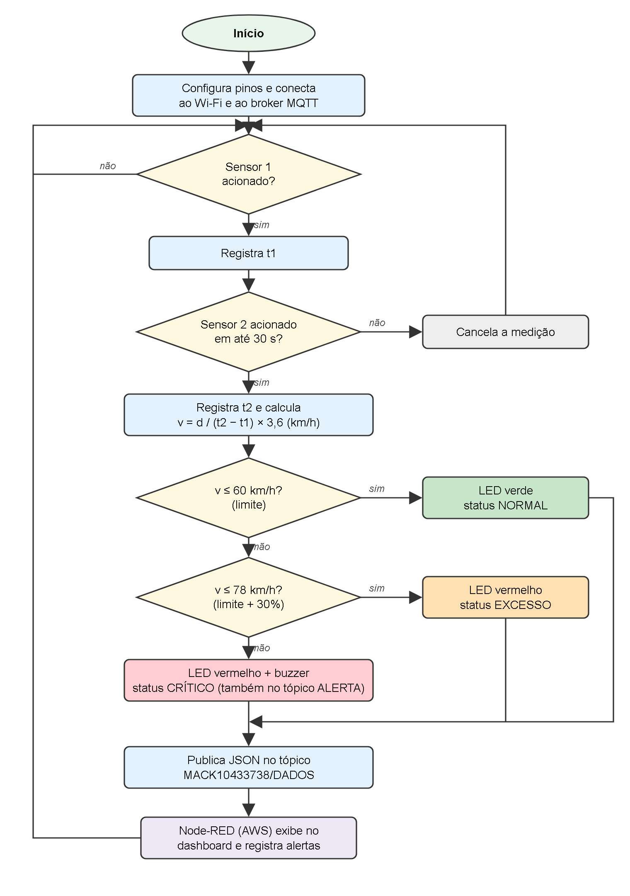
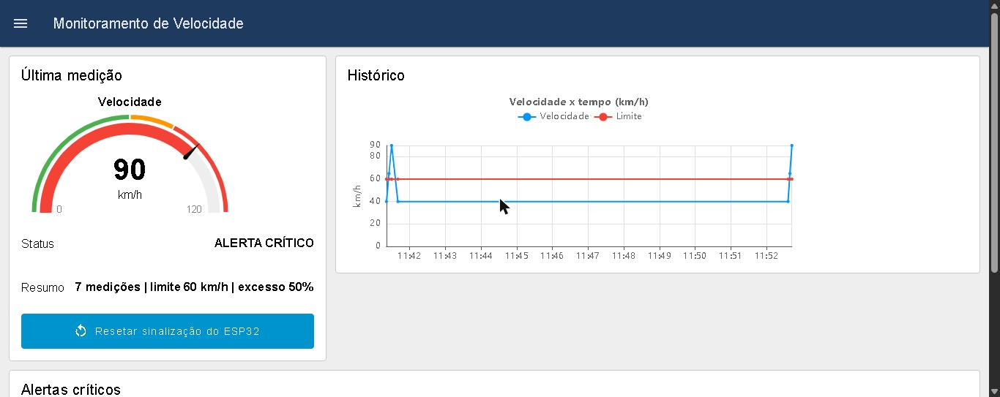
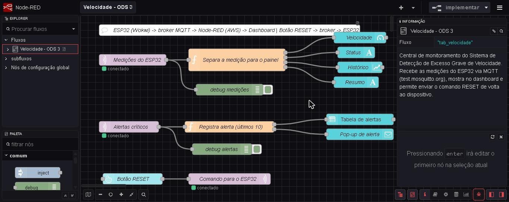
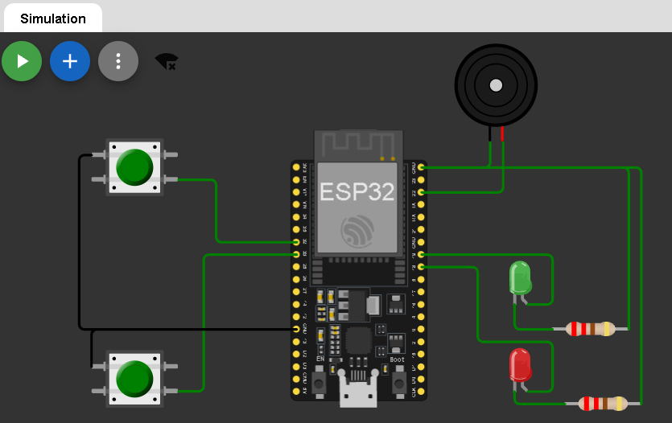

# Sistema de Detecção de Excesso Grave de Velocidade

Protótipo IoT alinhado ao **ODS 3 (Saúde e Bem-Estar), meta 3.6**: reduzir mortes e ferimentos no trânsito.
Dois sensores infravermelhos de barreira, a uma distância conhecida, medem o tempo de passagem de um veículo.
O ESP32 calcula a velocidade, compara com o limite da via, aciona LEDs e buzzer e publica cada medição via
**MQTT** para uma central de monitoramento em **Node-RED hospedado na AWS**.

Projeto da disciplina **Objetos Inteligentes Conectados** · Universidade Presbiteriana Mackenzie · 2026/2

- **Simulação no Wokwi:** https://wokwi.com/projects/481581609051616257
- **Vídeo de apresentação:** https://youtu.be/nB-RlylkOhQ

### O que tem neste repositório

| Pasta | Conteúdo |
|---|---|
| [`firmware/`](firmware/) | Código do ESP32 (`sketch.ino`), circuito do Wokwi (`diagram.json`) e bibliotecas |
| [`node-red/`](node-red/) | Fluxo da central de monitoramento (importar no Node-RED) |
| [`aws/`](aws/) | Script que instala o Node-RED na instância EC2 |
| [`docs/`](docs/) | Fluxograma e diagrama de montagem |

---

## 1. Como funciona



1. O veículo interrompe o feixe do **Sensor 1** → o ESP32 guarda o instante `t1`.
2. O veículo interrompe o feixe do **Sensor 2** → guarda `t2` (se não vier em 30 s, a medição é cancelada).
3. Velocidade: `v = d / (t2 − t1) × 3,6` (km/h), com `d = 0,50 m`.
4. Classificação (limite de 60 km/h, configurável no código):

| Faixa | Status | Atuadores |
|---|---|---|
| v ≤ 60 km/h | `NORMAL` | LED verde |
| 60 < v ≤ 78 km/h | `EXCESSO` | LED vermelho |
| v > 78 km/h (limite + 30%) | `CRITICO` | LED vermelho + buzzer (1 s) + mensagem no tópico de alerta |

5. Toda medição é publicada em JSON no broker MQTT. O Node-RED (na AWS) mostra no dashboard e guarda os alertas.
6. Pelo dashboard, o botão **Resetar sinalização** envia `RESET` ao ESP32, que apaga LEDs e buzzer (comando remoto pela internet).

> O limite crítico de 30% é uma regra experimental do protótipo, não uma classificação legal de infração.

### Funcionando

Painel do Node-RED (na AWS) recebendo as medições do ESP32 simulado no Wokwi:



Fluxo no Node-RED:



## 2. Hardware

| Componente | Função | Ligação no ESP32 |
|---|---|---|
| ESP32 DevKitC V4 | Processamento, Wi-Fi e MQTT | – |
| Sensor IR de barreira 1 | Início da medição | GPIO 32 (INPUT_PULLUP) |
| Sensor IR de barreira 2 | Fim da medição | GPIO 33 (INPUT_PULLUP) |
| LED verde + resistor 220 Ω | Velocidade normal | GPIO 19 |
| LED vermelho + resistor 220 Ω | Excesso / crítico | GPIO 18 |
| Buzzer piezoelétrico | Alerta sonoro crítico | GPIO 22 |

**Simulação:** o Wokwi não tem o par emissor/receptor IR de barreira, então cada sensor é representado por um
**pushbutton** ligado ao mesmo GPIO. Apertar o botão equivale a interromper o feixe (nível LOW). Na montagem
física, basta trocar os botões pelos sensores, sem mudar o código.



## 3. Software

| Parte | Ferramenta | Arquivo |
|---|---|---|
| Firmware do ESP32 (C++/Arduino) | IDE do **Wokwi** (compatível com Arduino IDE) | [`firmware/sketch.ino`](firmware/sketch.ino) |
| Circuito da simulação | Wokwi | [`firmware/diagram.json`](firmware/diagram.json) |
| Bibliotecas | `WiFi.h` (nativa do ESP32), `PubSubClient` | [`firmware/libraries.txt`](firmware/libraries.txt) |
| Central de monitoramento | **Node-RED** + Dashboard 2.0 (`@flowfuse/node-red-dashboard`) | [`node-red/flows.json`](node-red/flows.json) |
| Servidor da central | **AWS EC2** (Ubuntu) | [`aws/instalar-node-red.sh`](aws/instalar-node-red.sh) |

O código segue a estrutura usada nas aulas: configurações no topo, `callback` (mensagens recebidas do broker),
reconexão ao broker, `medirVelocidade()` (cálculo, atuadores e publicação), `setup()` e `loop()`.

## 4. Comunicação: Wi-Fi (TCP/IP) e MQTT

- **Wi-Fi:** o ESP32 conecta como estação (`WIFI_STA`) na rede `Wokwi-GUEST` do simulador, que dá acesso à internet.
- **Protocolo:** MQTT 3.1.1 sobre TCP, modelo publish/subscribe, biblioteca PubSubClient.
- **Broker:** `test.mosquitto.org`, porta `1883` (broker público, sem autenticação).
- **Reconexão automática:** o ESP32 tenta o broker a cada 5 s sem travar a leitura dos sensores.

| Tópico | Quem publica | Quem assina | Conteúdo |
|---|---|---|---|
| `MACK10433738/DADOS` | ESP32 | Node-RED (e o próprio ESP32, para medir o eco) | Toda medição (JSON) |
| `MACK10433738/ALERTA` | ESP32 | Node-RED | Só medições `CRITICO` (JSON) |
| `MACK10433738/COMANDO` | Node-RED | ESP32 | `RESET` apaga LEDs e buzzer |

Exemplo de mensagem:

```json
{"velocidade":90.00,"limite":60.00,"percentual_excesso":50.00,"status":"CRITICO"}
```

### Fluxo no Node-RED

`mqtt in` (DADOS) → `function` (separa a medição) → dashboard: ponteiro de velocidade, status, resumo e gráfico com a linha do limite
`mqtt in` (ALERTA) → `function` (guarda os 10 últimos) → tabela de alertas + pop-up
`ui-button` (RESET) → `mqtt out` (COMANDO) → ESP32

## 5. Como reproduzir

**Simulação (ESP32):**
1. Abra o projeto no Wokwi (link acima) ou crie um projeto ESP32 e cole `sketch.ino`, `diagram.json` e `libraries.txt`.
2. Clique em ▶. No Monitor Serial deve aparecer `Wi-Fi conectado!` e `Conectando ao broker MQTT... conectado!`.
3. Aperte o botão de cima (Sensor 1) e depois o de baixo (Sensor 2). Quanto mais rápido, maior a velocidade.
4. Ou digite no Monitor Serial: `1` (40 km/h), `2` (65 km/h), `3` (90 km/h).

**Central (Node-RED na AWS):**
1. No AWS Academy Learner Lab, crie uma instância EC2 **Ubuntu Server**, tipo **t2.medium**, com SSH, HTTP e HTTPS liberados.
2. No Security Group da instância, adicione uma regra de entrada *Custom TCP* na porta **1880**.
3. No terminal da instância (EC2 Instance Connect):
   ```bash
   curl -fsSLO https://raw.githubusercontent.com/fabiorod20/objetos_inteligentes_conectados_ODS3/main/aws/instalar-node-red.sh
   bash instalar-node-red.sh
   ```
   O script atualiza o Ubuntu e instala nvm, Node.js, Node-RED, Dashboard 2.0 e pm2 (o Node-RED volta sozinho após reinício).
4. Abra `http://<IP-público>:1880` → menu ☰ → **Import** → cole o conteúdo de `node-red/flows.json` → **Deploy**.
5. Dashboard: `http://<IP-público>:1880/dashboard`.

**Ver o broker funcionando:** com o MQTT Explorer (ou outro cliente MQTT), conecte em `test.mosquitto.org:1883`
e abra o tópico `MACK10433738/#`.

## 6. Medição dos tempos de resposta

A cada medição o firmware mostra no Monitor Serial:

- **Detecção → atuador:** do sensor 2 até o acionamento dos LEDs e do buzzer (µs).
- **Ida e volta MQTT:** ESP32 → broker → ESP32, usando o eco do próprio tópico de dados (ms).

Os valores medidos estão na seção de Resultados do artigo.

## 7. Autores

Fabio Capalbo Payão Rodrigues · Gabriel Vieira Ferreira · Luiz Henrique de Lapaz
